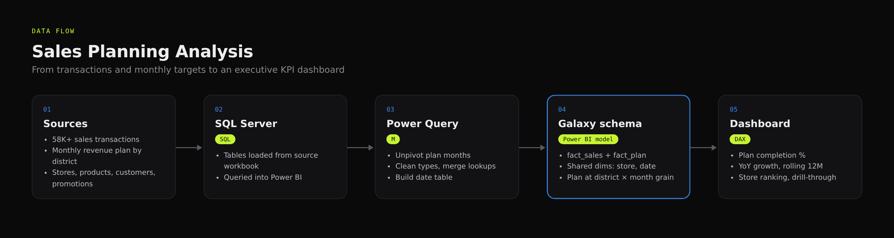
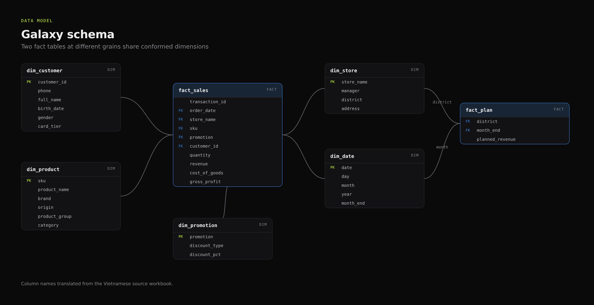
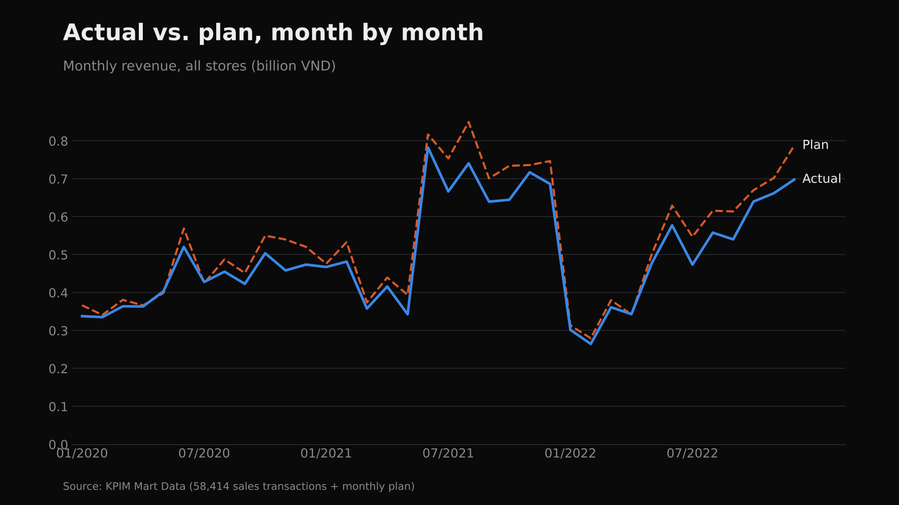
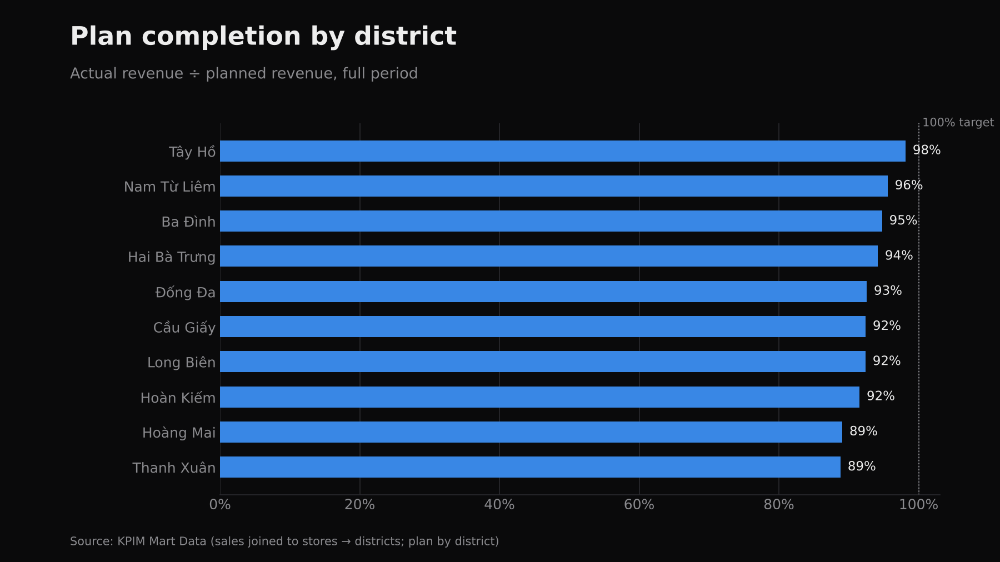

# Sales Planning Analysis (Power BI · Galaxy Schema)

A Power BI dashboard (Aug 2025) for the KPIM Mart retail chain that compares **actual sales against monthly plans** by store, product group, region, and time, so managers can see who is on track and where targets are at risk.

## Business questions
- Which stores, regions, and product groups are meeting their monthly plan, and which are falling behind?
- How is performance trending year over year and over the last 12 months?

## Data model: galaxy schema
Two fact tables share conformed dimensions, so actual and planned figures can be compared at any grain:

- **Facts:** Sales (about 58K transaction lines) and Plan (monthly targets)
- **Dimensions:** Store, Product, Category, Customer, Promotion, Date

## Key measures (DAX)
- Plan completion % = Actual ÷ Plan
- Year-over-year growth %
- Rolling 12-month trend
- Store and region rankings

## Report features
KPI cards · actual-vs-plan monthly trend · store ranking · product-group and regional breakdowns · slicers and drill-through to store detail

## Files
| File | Description |
|---|---|
| `KPIM Mart Sales Report Datathon 3.pbix` | Main report |
| `Capstone Project.pbix` | Extended version of the report |
| `KPIM Mart Data.xlsx` | Source data and data dictionary |

## How to open
Open either `.pbix` file in Power BI Desktop. If prompted, point the data source to `KPIM Mart Data.xlsx`.

## Skills demonstrated
Galaxy-schema modeling · DAX time intelligence · Power Query data preparation · executive dashboard design

## Power BI dashboard

## Gallery

_Diagrams are editable in draw.io: [`docs/diagrams/`](docs/diagrams)._

**Data flow: workbook to SQL Server to Power BI**

**Galaxy schema: sales and plan facts on shared dimensions**

**Actual vs. plan revenue**

**Plan completion by district**

